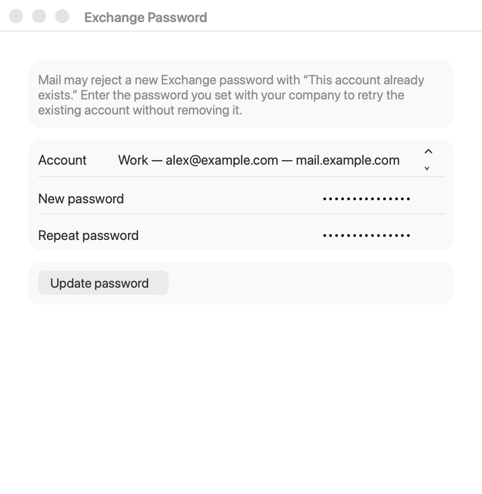

# macOS Mail Exchange Password Changer

After a company password change, macOS Mail may reject the new Exchange password with “This account already exists.” The usual workaround is to remove and recreate the account.

This utility asks Mail to store the new password on the existing account. If macOS accepts it, Mail reconnects without removing the account, changing its settings, or downloading its data again.

It does not change your company password. Use it after changing that password through your company.



## Install

Download the DMG from [Releases](https://github.com/adrianov/macos-exchange-password-changer/releases), then drag **Exchange Password** to Applications. The app is not notarized, so right-click it and choose **Open** on the first launch.

Choose the Exchange account, enter its new password twice, and click **Update password**. On the first run, allow control of Mail and System Events in **System Settings → Privacy & Security → Automation**.

Some macOS versions keep the password only temporarily and reject the permanent save with the same “account already exists” error. Internet Accounts has no separate approval for this case; removing and adding the account again remains the system workaround.

## Build from source

```sh
./build.sh
open "build/Exchange Password.app"
```

Copyright © 2026 Peter Adrianov. Licensed under the MIT License.
